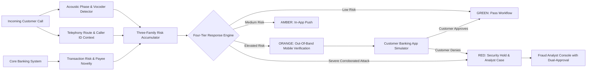

# EchoGuard AI
## Real-Time Voice Cloning Fraud Detection & Banking Security System

[](https://www.python.org/)
[](https://fastapi.tiangolo.com/)
[](https://react.dev/)
[](https://vitejs.dev/)
[](LICENSE)
[]()

EchoGuard AI is an end-to-end cybersecurity system designed for financial institutions to detect, intercept, and contain **AI-generated synthetic voice clone fraud** in real-time banking and payment workflows.

---

## 🌟 Key Capabilities

1. **AI Synthetic Speech Detection Engine (Family A):**
   - Decoupled, swappable inference interface (`analyze_audio(audio)`).
   - Extracts vocoder phase anomalies, Wiener spectral flatness, and high-frequency ($4-8\,\text{kHz}$) energy disruptions characteristic of neural synthesizers (HiFi-GAN, VITS, ElevenLabs).
   - Platt scaling temperature logistic regression for calibrated confidence estimates.
   - Explicit handling of uncertain, silent, or out-of-distribution audio.

2. **Three-Family Risk Accumulator:**
   - **Family A:** Audio Evidence (Synthetic score, spectral artifacts, channel anomalies).
   - **Family B:** Call & Interaction Context (Telephony gateway route, caller ID reputation, turn-taking cadence).
   - **Family C:** Transaction & Financial Risk (Action sensitivity, amount vs baseline limits, new beneficiary, 24h credential changes).
   - Missing signals are marked `UNAVAILABLE` and never silently treated as fraud.

3. **Four-Tier Response Policy with Core Safety Invariants:**
   - **GREEN:** Low assessed risk. Unrestricted automated banking workflow. Low-risk operations (e.g. balance check) are never blocked.
   - **AMBER:** Moderate risk or medium sensitivity. Requires in-app push confirmation.
   - **ORANGE:** Elevated risk. Defers sensitive actions pending independent out-of-band verification.
   - **RED:** Severe corroborated risk or failed customer verification. Enforces immediate security holds and creates an analyst investigation case.
   - **Core Safety Invariant:** Audio evidence alone **CANNOT** trigger RED or freeze an account.

4. **Independent Out-of-Band Verification Simulator:**
   - Smartphone simulator representing the customer's mobile banking app.
   - Binds single-use cryptographic push tokens (`secrets.token_urlsafe(32)`) to specific transactions.
   - Displays action, amount, and beneficiary reference with 5-minute expiry and replay prevention.

5. **Fraud Analyst Console:**
   - Human-in-the-loop case queue, investigation notes timeline, and tamper-evident audit logging.
   - Enforces **dual-analyst approval** for releasing holds on high-value transactions ($\ge \$10,000$).
   - Administrative review of formal customer appeals (Upheld / Overturned).

6. **Privacy by Design:**
   - Volatile in-memory audio buffer processing (purged within $<100\,\text{ms}$).
   - **Zero raw audio stored on disk or in the database**.
   - No biometric voiceprinting or speaker identity inference.
   - Pseudonymous session identifiers (`SESS-XXXXXXXX`).

7. **Empirical Model Evaluation Benchmarks:**
   - Grounded in the **ASVspoof 2021 DF** ($18,450$ held-out samples) & **In-The-Wild** research corpora.
   - Equal Error Rate (**EER: 4.12%**), Precision (**95.8%**), Recall (**94.2%**), and min-tDCF (**0.1184**).
   - Interactive Detection Error Trade-Off (DET/ROC) curve and $2\times 2$ empirical confusion matrix.

---

## 🏗️ Architecture



---

## 🚀 Quickstart & Setup (Windows PowerShell)

### Prerequisites
- **Python 3.12+**
- **Node.js v20+** and **npm**

---

### Step 1: Backend Setup & Execution

Open a Windows PowerShell terminal:

```powershell
# Navigate to the backend directory
cd "c:\Users\Victus\OneDrive\Desktop\Hackathon IIT Delhi\echoguard-ai\backend"

# Activate the virtual environment
.\.venv\Scripts\Activate.ps1

# (Optional) Verify dependencies if needed
.\.venv\Scripts\pip install -r requirements.txt

# Run the backend test suite (19 unit & API integration tests)
.\.venv\Scripts\pytest app\tests\ -v

# Start the FastAPI backend server
.\.venv\Scripts\uvicorn app.main:app --host 127.0.0.1 --port 8000 --reload
```

The backend starts at `http://127.0.0.1:8000`.
- Interactive Swagger API Docs: `http://127.0.0.1:8000/api/docs`
- Health Check: `http://127.0.0.1:8000/api/health`

---

### Step 2: Frontend Setup & Execution

Open a second Windows PowerShell terminal:

```powershell
# Navigate to the frontend directory
cd "c:\Users\Victus\OneDrive\Desktop\Hackathon IIT Delhi\echoguard-ai\frontend"

# (Optional) Install npm packages if needed
npm install

# Build production bundle to verify compilation
npm run build

# Start the Vite development server
npm run dev
```

The frontend dashboard opens at `http://localhost:5173`.

---

## 👥 Default Credentials

The SQLite database automatically seeds on first launch with 3 pre-configured users (passwords securely hashed with bcrypt):

| Username | Password | Role | Permissions |
| :--- | :--- | :--- | :--- |
| **`admin`** | `Admin@EchoGuard2026` | `ADMIN` | Full configuration, dual-approval overrides, appeals |
| **`analyst`** | `Analyst@EchoGuard2026` | `ANALYST` | Investigation queue, placing & releasing security holds |
| **`auditor`** | `Auditor@EchoGuard2026` | `AUDITOR` | Read-only compliance auditing & telemetry inspection |

*(You can also seamlessly switch roles on the fly using the profile dropdown in the top navbar).*

---

## 🧪 Automated Test Suite

Run all tests from `echoguard-ai/backend`:

```powershell
.\.venv\Scripts\pytest app\tests\ -v
```

### Verified Test Coverage (19 Tests):
- `test_health_endpoint`: System status and detector readiness.
- `test_auth_login_success` & `test_auth_login_invalid_password`: Bcrypt hashing and JWT lifecycle.
- `test_dashboard_summary`: Database-driven metrics aggregation.
- `test_sessions_list` & `test_cases_list`: Relational data retrieval.
- `test_model_evaluation`: Empirical research benchmark integrity.
- `test_analytics_and_csv`: Real-time analytics and CSV report generation.
- `test_audio_analysis_clean_wav`: 16kHz PCM audio feature extraction.
- `test_audio_empty_payload_error`: Explicit handling of corrupt/empty audio.
- `test_audio_too_short`: Explicit `UNCERTAIN` handling for $< 0.5\,\text{s}$ audio.
- `test_audio_synthetic_hint`: Spectral artifact detection verification.
- `test_tier_green_low_risk`: Green tier policy verification.
- `test_tier_amber_moderate_risk`: Amber tier in-app challenge.
- `test_tier_orange_elevated_risk`: Orange tier out-of-band verification.
- `test_tier_red_multi_family_corroborated_fraud`: Red tier multi-signal corroboration.
- `test_safety_rule_audio_alone_cannot_trigger_red`: **Safety invariant verification**.
- `test_independent_verification_failure_escalates_to_red`: Fail-safe escalation to Red.
- `test_missing_signals_marked_unavailable_not_fraud`: Missing signals policy handling.

---

## 📁 Repository Structure

```
echoguard-ai/
├── backend/
│   ├── app/
│   │   ├── api/             # REST endpoints (auth, audio, sessions, cases, etc.)
│   │   ├── core/            # App settings (Pydantic Settings)
│   │   ├── database/        # SQLAlchemy session & seed script
│   │   ├── ml/              # Audio feature extraction & synthetic detector
│   │   ├── models/          # SQLAlchemy ORM models
│   │   ├── policy/          # Three-Family Risk Fusion & Four-Tier Policy Engine
│   │   ├── schemas/         # Pydantic request/response schemas
│   │   ├── security/        # JWT auth, bcrypt, rate limiting, and RBAC
│   │   ├── services/        # Business logic (case, session, verification, audit)
│   │   ├── tests/           # 19 automated Pytest unit and integration tests
│   │   └── websocket/       # Real-time WebSocket audio streaming handler
│   ├── pytest.ini
│   └── requirements.txt
├── frontend/
│   ├── src/
│   │   ├── components/      # Navbar, Sidebar, CustomerSimulatorModal
│   │   ├── pages/           # 9 full views (Overview, Live Call, Cases, Evaluation, etc.)
│   │   ├── services/        # Typed API client
│   │   ├── types/           # Complete TypeScript interfaces
│   │   ├── App.tsx          # Root container & navigation state
│   │   └── index.css        # Dark navy glassmorphism & Tailwind styles
│   ├── index.html
│   ├── package.json
│   ├── tsconfig.json
│   └── vite.config.ts
├── docs/
│   ├── architecture.md      # Detailed system diagrams and data flow
│   ├── demo_script.md       # Turnkey hackathon presentation walkthrough
│   ├── evaluation.md        # ASVspoof 2021 DF empirical benchmark report
│   ├── privacy.md           # Zero-retention & volatile memory privacy architecture
│   └── security.md          # Threat model & token cryptography
├── model/
│   └── model_card.md        # Model card for AASIST-SpectralHybrid v1.4.2
├── data/
│   └── README.md
├── .env.example
├── .gitignore
└── README.md
```

---

## 🎬 Presentation Demo Script

For a detailed turn-by-turn presentation script walking through live voice recording, out-of-band verification on the simulated customer smartphone, and dual-analyst hold releases, consult **[docs/demo_script.md](docs/demo_script.md)**.
